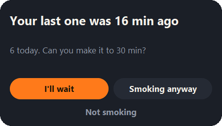
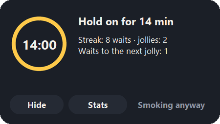
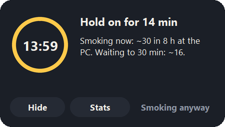
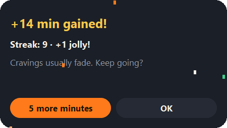
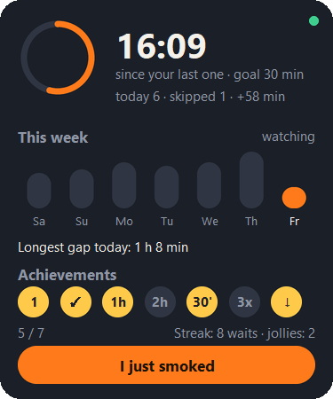

# you-just-smoked

A local webcam companion that notices when you're about to smoke and asks you, once, to wait a little longer. No cloud, no account, no images saved.

<p align="center">
  
</p>

It does not try to make you quit. It tries to buy you a little time between cigarettes, because a few minutes, many times a day, add up.

> **Status: early, and tested by one person on one Windows laptop.** It works well enough to be useful there. It has never been run on macOS or Linux, and the detection is tuned on a single person and webcam. See [Where it has been tested](#where-it-has-been-tested).

## What you see

Nothing, while you work: only a small icon by the clock.

**When you're about to smoke** (rolling a cigarette in front of the camera, or bringing a flame or your hand to your mouth), a card slides in once, with a chime. It tells you when your last one was, how many you've had today, and offers a goal a few minutes away.

**If you choose to wait**, it counts down to that goal (never more than 25 minutes) and keeps you company, cycling through:

- your streak of waits seen through, and the jollies it earned;
- the next badge within reach ("One hour clear in 6 min");
- today against yesterday by this time;
- the pace: "Smoking now: ~30 in 8 h at the PC. Waiting to 30 min: ~16.";
- small tips: a glass of water, three deep breaths…

<p align="center">
  
  
</p>

**Hide** folds it into a tab on the screen edge that keeps showing the time left. When time is up it chimes, comes back and celebrates.

<p align="center">
  
  &nbsp;&nbsp;
  
</p>

**The tray icon** shows today's numbers. From its menu you can open the statistics card, log a cigarette it missed, pause for an hour, or quit.

<p align="center">
  
</p>

- **Streak and jollies:** every wait you see through adds to your streak, and every third earns a jolly. Smoking during a wait spends a jolly instead of breaking the streak.
- **Achievements:** first wait, first one skipped, one hour clear, two hours clear, 30 minutes gained, three skipped in a day, fewer than the day before.

## How it works

```
 webcam ──▶ hands + face ──▶ cues ──▶ evidence ──▶ episode ──▶ one nudge
 (sparse)   (MediaPipe)      rolling   decays       state       and an
                             flame     over time    machine     honest log
                             puff
                             objects*
```

- **Many cues, one decision.** Rolling, a flame near your face, a hand coming to your mouth: each cue only adds evidence, and evidence fades within about a minute. A single glimpse means nothing; several cues close together open an **episode**.
- **One nudge per cigarette.** Only opening an episode shows the nudge. Lighting up, puffing and everything after it refine the same episode, and a short quiet period afterwards stops one long cigarette from counting twice.
- **Your answer matters.**
  - **I'll wait:** the episode is put on hold. If you light up later, it is logged with the time you held off; if you don't, it is logged as skipped.
  - **Smoking anyway:** nothing else bothers you.
  - **Not smoking:** kept as a label for tuning, never counted.
- **The camera is off most of the time.** It takes one snapshot every 15 seconds and releases the camera. It streams at 2 fps for a short while only when something looks suspicious or a hand comes near your face, and it is off while paused or right after a cigarette.

The design is in [docs/architecture.md](docs/architecture.md) and the cue heuristics in [docs/detection.md](docs/detection.md).

## What it can and cannot see

| Cue | Status | How |
|---|---|---|
| Rolling | works, **if your hands are in frame** | both hands' fingertips together below the face |
| Flame near face or hand | works | small clipped-white blob with a warm rim |
| Hand coming to the mouth | works, but also fires on drinking or biting nails | pinched fingertips arriving at the mouth; never enough alone |
| Lighter, pack, papers, filter tips, cigarette | **not detected** without a model you supply | optional MediaPipe object detector |

- **Framing decides a lot.** Most laptop cameras only see your face, so rolling on the desk is invisible; the app then notices you when the flame or your hand reaches your face. Run `you-just-smoked preview` to see what your camera sees.
- **Expect false alarms at first.** These are heuristics. Answering **Not smoking** is exactly the data needed to improve them.
- **No public dataset** exists for packs, lighters or rolling papers. Building one, collected locally and opt-in, is the main item on the roadmap.

## Where it has been tested

| Platform | Status |
|---|---|
| Windows 11, USB webcam | tried for real by the author while building it; everything in this README was checked here |
| macOS (Apple Silicon) | **never run.** Tests pass in CI, but the app itself has not been started. The tray icon and the windows share the main thread there, which may need work. |
| Linux (x86-64, arm64) | **never run.** Tests pass in CI. Needs Tk (`sudo apt install python3-tk`) and a tray that supports AppIndicator; window corners are square. |

If you try it on macOS or Linux, an issue with what happened is the most useful contribution right now.

## Privacy

- Everything runs on your computer. There is no account and no network call, except the one-time download of two public MediaPipe models, pinned by SHA-256.
- Frames are analysed in memory and discarded. **No image or video is ever written to disk.**
- The only data stored is a small SQLite log of episodes: start and end time, outcome, the cue that triggered it, your answer and the wait you accepted. `you-just-smoked paths` shows where it lives.

## Install

You need Python 3.11 or newer and a terminal. There is no installer yet.

```bash
git clone https://github.com/itsma77e/you-just-smoked.git
cd you-just-smoked
python -m venv .venv
```

Activate the environment (Windows: `.venv\Scripts\activate`, macOS/Linux: `source .venv/bin/activate`), then:

```bash
pip install -e .
```

## Use

```bash
you-just-smoked            # start watching, with an icon in the tray
you-just-smoked preview    # live window: landmarks, cues and whether it would nudge
you-just-smoked status     # today's numbers
you-just-smoked paths      # where config, data and logs live
```

Settings are optional; see [docs/configuration.md](docs/configuration.md).

## Resource use

Measured on the Windows laptop above:

- **CPU:** a few percent of one core when nothing is happening. Most of it is opening and closing the camera; analysing a frame takes about 25 ms. It is higher for the seconds it streams.
- **Memory:** about 270 MB in total, mostly the MediaPipe runtime. The interface is plain Tk drawn with Pillow (about 20 MB), not a web view (about 280 MB).
- **A Windows quirk:** every webcam open leaks a few MB inside the system's capture stack. The camera therefore runs in a small helper process, restarted every 20 opens, so the app's memory stays flat.

If you don't mind the camera light staying on, `keep_open = true` makes snapshots cheaper.

## Roadmap

- Try it on macOS and Linux, and fix what breaks.
- An installer that starts at login, so non-programmers can use it.
- Opt-in local dataset collector and a trained detector for lighters, packs, papers and filter tips.
- Per-user calibration from your answers.
- More languages (currently English and Italian).

## Contributing

Contributions are welcome, especially reports from macOS and Linux, detection ideas and translations. See [CONTRIBUTING.md](CONTRIBUTING.md).

## A note on health

This is not a medical device and not a substitute for support. If you want to quit, free help works and is worth it. The [WHO quitting tobacco page](https://www.who.int/activities/quitting-tobacco) lists options, and most countries have a free national quitline.

## License

[MIT](LICENSE)
